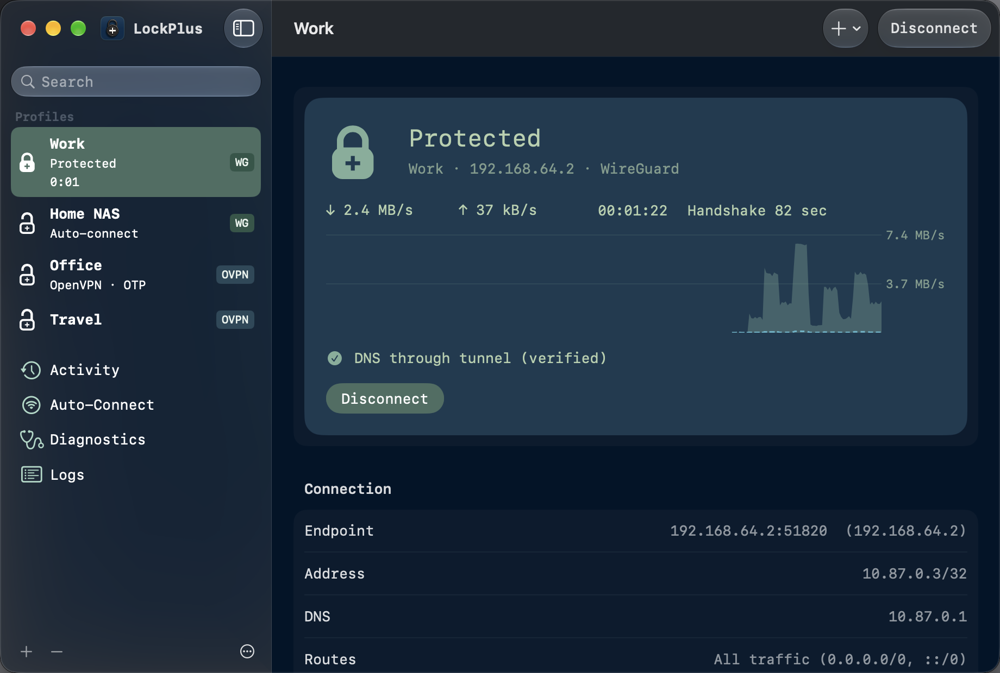
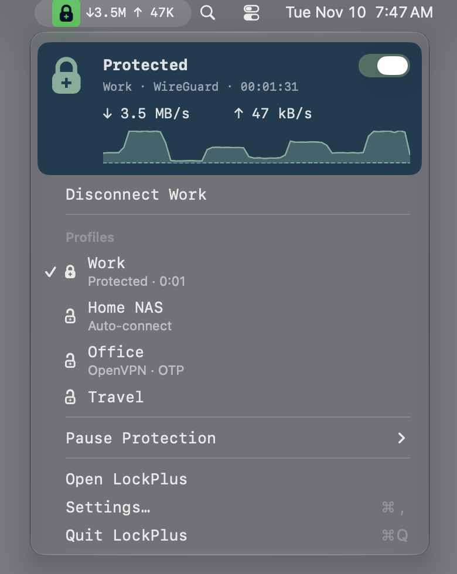
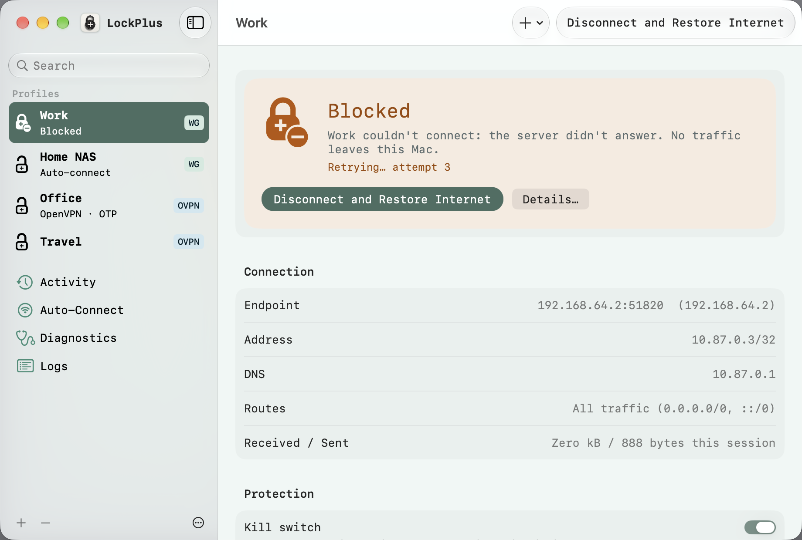
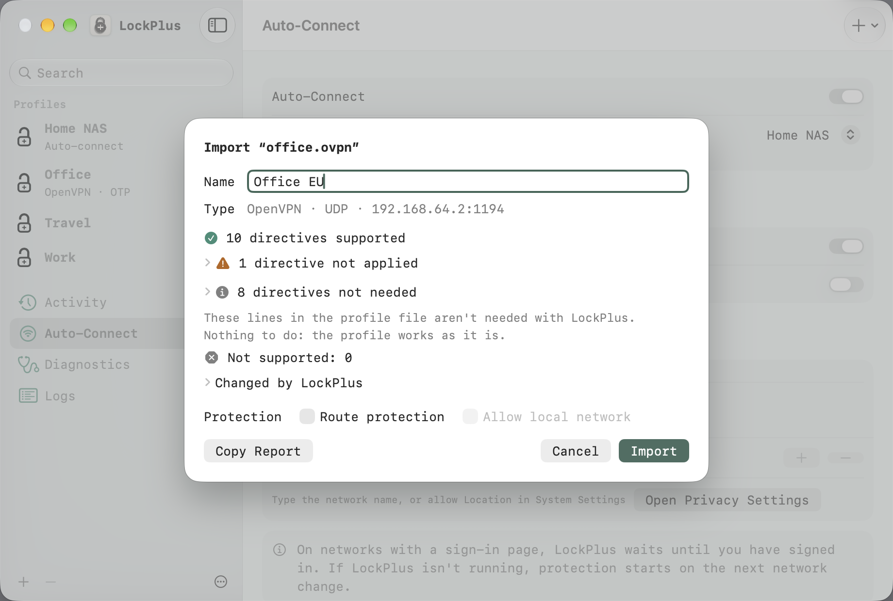
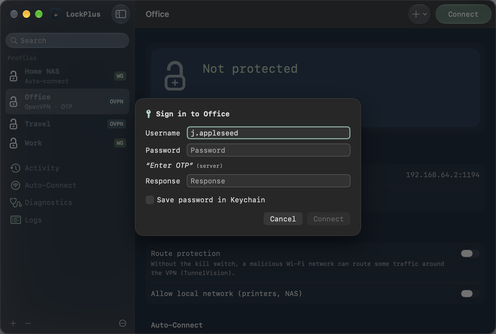
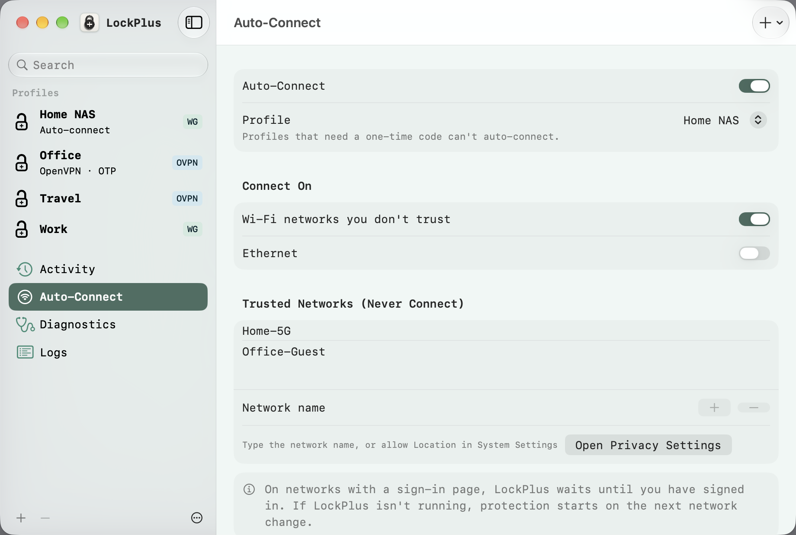
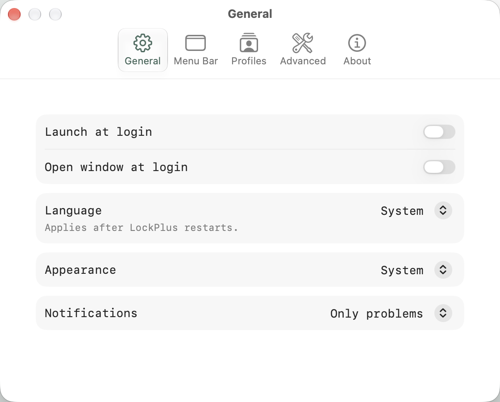

<p align="center">
  <picture>
    <source media="(prefers-color-scheme: dark)" srcset="docs/appicon-dark.png">
    
  </picture>
</p>

<h1 align="center">LockPlus</h1>

<p align="center">
  <b>WireGuard and OpenVPN for the Mac, with a kill switch that macOS itself enforces.</b>
</p>

<p align="center">
  <a href="https://github.com/steiale/lockplus-updates/releases/latest"></a>
  
  
  <a href="LICENSE"></a>
</p>

<p align="center">
  <a href="https://github.com/steiale/lockplus-updates/releases/latest/download/LockPlus.dmg"><b>⬇︎ Download LockPlus 2</b></a>
  &nbsp;·&nbsp; <a href="https://github.com/steiale/lockplus-updates/releases">Release notes</a>
  &nbsp;·&nbsp; <a href="#upgrading-from-lockplus-1x--wireguide">Upgrading from 1.x</a>
  &nbsp;·&nbsp; <a href="https://github.com/steiale/lockplus/issues">Issues</a>
</p>

<p align="center">
  <picture>
    <source media="(prefers-color-scheme: light)" srcset="docs/screenshots/2.0/main-protected-light.png">
    
  </picture>
</p>

<table>
  <tr>
    <td width="33%" valign="top"><b>A kill switch macOS enforces</b><br>With the kill switch on, macOS itself blocks every packet outside the tunnel, also while it reconnects. Disconnect always gets you back online.</td>
    <td width="33%" valign="top"><b>WireGuard and OpenVPN in one app</b><br>Including OpenVPN sign-in with one-time codes and challenge/response, and a new code on reconnect.</td>
    <td width="33%" valign="top"><b>No root helper, no password</b><br>The tunnel runs in a system extension you approve once. No background daemon, no administrator prompt to connect.</td>
  </tr>
</table>

## Why LockPlus

I needed one Mac client for both WireGuard and OpenVPN: WireGuard for my own servers, OpenVPN with one-time codes for
work. I tried the clients that exist and found none I liked: none with a real kill switch for both protocols and a UI
I'd want to look at every day. So I built one. LockPlus 1 started as a fork of WireGuide (see [Credits](#credits)) and
ran from version 1.0 to 1.2. LockPlus 2 is the same app rebuilt natively.

## A look around

<table>
  <tr>
    <td width="50%" valign="top"><br><b>Menu bar.</b> Live rates, a status header with a graph, one-click profile switching and Pause Protection.</td>
    <td width="50%" valign="top"><br><b>Blocked, on purpose.</b> When the server drops, the kill switch holds your traffic while LockPlus reconnects, and says so.</td>
  </tr>
  <tr>
    <td valign="top"><br><b>Import with a report.</b> Every OpenVPN directive is checked before anything is saved: supported, not needed, not applied (with the reason) or not supported.</td>
    <td valign="top"><br><b>OpenVPN sign-in.</b> Password plus one-time code, or the server's challenge, right in the app.</td>
  </tr>
  <tr>
    <td valign="top"><br><b>Auto-connect.</b> On Wi-Fi networks you don't trust and/or on Ethernet, with a trusted list. Works even when LockPlus isn't running.</td>
    <td valign="top"><br><b>Settings.</b> Short and plain. English and German.</td>
  </tr>
</table>

## Features

- **WireGuard and OpenVPN.** WireGuard through [wireguard-go](https://git.zx2c4.com/wireguard-go/about/), OpenVPN through
  [OpenVPN 3](https://github.com/OpenVPN/openvpn3) (`release/3.11.8`), both inside the extension. OpenVPN with a password, a static challenge (one-time code typed with the password) or dynamic
  challenge/response (CRV1), including a new code when the server asks for one on reconnect.
- **Kill switch.** Blocks all traffic outside the tunnel, including when the connection drops. "Allow local network"
  lets printers and NAS through if you want. Split-tunnel profiles get *route protection*: their routes are kept in the
  tunnel, but other traffic isn't blocked (the app says so).
- **Auto-connect on untrusted networks**, through macOS's on-demand rules, so it also starts when LockPlus isn't running.
- **Pause** protection for a set time (for a hotel or café sign-in page); it resumes by itself.
- **DNS verification:** "DNS through tunnel (verified)", or what is wrong.
- **Honest status.** Protected, Not protected, Blocked, Paused, Sign-in needed: each state has its own icon shape and
  colour, and "Connecting…" and "Protected" are only shown when the system says so.
- **Import and editor** for `.conf`, `.ovpn` and zip files (also the WireGuard app's export), with syntax checks.
- **Diagnostics and logs:** routes, DNS resolvers, tunnel checks, and an export with secrets removed.
- **Migration from LockPlus 1.x:** profiles, kill switch and DNS settings, Wi-Fi auto-connect rules, history and, if
  you allow it, saved OpenVPN logins. Your 1.x data is never changed.

## What changed in LockPlus 2

LockPlus 1 was a Go/Wails app that ran its tunnels in a root helper and built its kill switch from `pf` firewall rules.
That worked, but it needed an administrator password, a privileged daemon that stayed installed, and firewall rules
that other software could change. LockPlus 2 is a native SwiftUI/AppKit app with a
[Network Extension](https://developer.apple.com/documentation/networkextension) (a
[packet tunnel provider](https://developer.apple.com/documentation/networkextension/nepackettunnelprovider) in a
[system extension](https://developer.apple.com/documentation/systemextensions)):

- **No root helper.** The tunnel runs in a system extension that macOS installs and starts after you approve it once.
  No LaunchDaemon, no `pf` rules, no admin prompt to connect.
- **A kill switch that macOS enforces.** With the kill switch on, LockPlus uses the system's
  [`includeAllNetworks`](https://developer.apple.com/documentation/networkextension/nevpnprotocol/includeallnetworks)
  setting: macOS blocks every packet that doesn't go through the tunnel, including while the tunnel reconnects.
- **One status, from the system.** The window, the menu bar and notifications all show the same state, derived from
  what macOS reports.

## Security model in brief

- **System extension.** Both engines run in LockPlus's packet tunnel provider, which macOS activates after you approve
  it once in System Settings. The app talks to it over XPC; the extension accepts only a correctly signed LockPlus app.
- **Per-user secrets.** Private keys and passwords live in the macOS keychain, per user. Profile files are sealed and
  authenticated, so a tampered profile is refused rather than used. Another user on the same Mac can't read your
  profiles or credentials. Nothing secret goes into logs or the diagnostics export.
- **No root helper anymore.** LockPlus 2 installs no privileged helper and asks for no administrator password to
  connect. Moving from 1.x removes the old helper.
- **Signed updates.** [Sparkle](https://sparkle-project.org), from a signed feed; every update is checked against LockPlus's EdDSA key and its
  Developer ID signature.
- **No telemetry, no accounts.**

## How LockPlus is built

I direct the work, make the decisions and am accountable for every release. Most of the code is written by AI coding
agents (Claude), working from a design document ([`docs/native/DESIGN.md`](docs/native/DESIGN.md)) that records every
decision and the measurements behind it.

- **Review.** Every security-relevant change went through dedicated AI security review passes. The reports, with their
  findings and how each was fixed, are in [`docs/reviews/`](docs/reviews/).
- **Tests.** About 880 automated tests, plus end-to-end runs of the released app on macOS 26 and 27 virtual machines
  (install, approval, import, connect, sign-in, auto-connect, kill switch, updates, migration from 1.x) with documented
  results. Numbers in this README are measured, not promised: for example the kill-switch window after a tunnel-process
  crash (1.3 to 1.7 s).
- **What this is not.** An AI review is not a human security audit. Independent review is welcome: read the code, the
  design and the reports, and open an issue (or a private vulnerability report for anything security-related).

## Install

**Requirements:** macOS 26 (Tahoe) or later, a Mac with Apple silicon, and approving the LockPlus system extension in
System Settings once at first launch.

[**Download LockPlus.dmg**](https://github.com/steiale/lockplus-updates/releases/latest/download/LockPlus.dmg), open it
and drag LockPlus to Applications. On first launch LockPlus asks you to allow its system extension and the VPN
configuration. LockPlus updates itself (Sparkle).

**Homebrew:** the cask for LockPlus 2 follows in a few weeks. Until then, please use the DMG.

## Upgrading from LockPlus 1.x / WireGuide+

LockPlus 2 is a new app; LockPlus 1 can't update itself to it. The way over is **LockPlus 1.2.0**, the last version of
LockPlus 1: it shows what LockPlus 2 will copy, and **Move to LockPlus 2 now** disconnects, removes the old background
helper (one administrator password prompt), downloads LockPlus 2 and checks its signature before opening the installer.
**Later** keeps LockPlus 1 working, with a banner to move when you're ready. On first launch LockPlus 2 copies your
profiles and settings; your 1.x files are never changed.

<details>
<summary><b>How you get 1.2.0, by version</b> (LockPlus or WireGuide+ › About)</summary>

| You have | How you get 1.2.0 |
|---|---|
| **1.0.65 – 1.1.0** | The in-app update offers 1.2.0, verifies it and shows the downloaded zip in Finder. Open it and drag **LockPlus** to Applications (Replace). |
| **1.0.28 – 1.0.62** (WireGuide+ 1.0.28 – 1.0.56, LockPlus 1.0.57 – 1.0.62) | The in-app update offers 1.2.0 and shows the downloaded DMG in Finder. Open it and drag **LockPlus** to Applications. WireGuide+ users: the new app is called LockPlus and sits next to WireGuide+; quit WireGuide+ first. |
| **1.0.63 – 1.0.64** | The in-app update can't check 1.2.0's signature and opens the releases page instead. **If the in-app update fails, download the DMG** ([lockplus-v1.2.0-darwin-arm64.dmg](https://github.com/steiale/lockplus/releases/download/v1.2.0/lockplus-v1.2.0-darwin-arm64.dmg)) and drag LockPlus to Applications. |
| **1.0.0 – 1.0.27** (WireGuide+) | The update check of most of these versions looks at the original WireGuide project, so it may not offer 1.2.0 (1.0.0 even offers "WireGuide 0.6.1": that is a different app, don't install it). If yours doesn't offer 1.2.0, download manually: with macOS 26 and Apple silicon, take [LockPlus 2](https://github.com/steiale/lockplus-updates/releases/latest/download/LockPlus.dmg) directly; otherwise the [1.2.0 DMG](https://github.com/steiale/lockplus/releases/download/v1.2.0/lockplus-v1.2.0-darwin-arm64.dmg). |

No 1.x version replaces the app by itself: every update ends with you opening the download and dragging LockPlus to
Applications. Then open the new LockPlus once.

</details>

<details>
<summary><b>Older macOS, Intel, Homebrew, WireGuide+ helper</b></summary>

- **macOS 13 – 15:** update to 1.2.0 and choose **Later**: LockPlus 2 won't start on your system, and 1.2.0 keeps
  working.
- **Intel Macs:** LockPlus has been Apple-silicon-only since 1.0.23. Neither 1.2.0 nor 2.0 runs there; WireGuide+ 1.0.22
  was the last Intel build.
- **Homebrew:** `brew upgrade --cask lockplus`, then quit and reopen LockPlus (Homebrew doesn't relaunch it). The old
  `wireguide-plus` cask is renamed to `lockplus`, so `brew upgrade` moves you over. If you used LockPlus 1.x, open it
  once before the cask moves to LockPlus 2, so its helper is removed.
- **WireGuide+ background helper:** WireGuide+ 1.0.1 – 1.0.56 installed a background helper of its own
  (`io.github.steiale.wireguide-plus.helper`). LockPlus 1.2.0 and 2.0 remove it for you; if you skipped both, remove it
  in Terminal (disconnect and quit WireGuide+ first), then move WireGuide+ to the Trash:

  ```sh
  sudo launchctl bootout system/io.github.steiale.wireguide-plus.helper 2>/dev/null
  sudo rm -f /Library/LaunchDaemons/io.github.steiale.wireguide-plus.helper.plist \
             /Library/PrivilegedHelperTools/io.github.steiale.wireguide-plus.helper
  ```

</details>

## FAQ

<details>
<summary><b>How tight is the kill switch?</b></summary>

With the kill switch on, macOS blocks all traffic outside the tunnel while the tunnel is connected, reconnecting, or
failed. The limits:

- If LockPlus's tunnel process crashes, macOS lets traffic through for **under 2 seconds** before it restarts the
  tunnel (1.3 to 1.7 s measured in the end-to-end runs on macOS 26 and 27). LockPlus 1's firewall rules didn't have
  this window.
- For the auto-connect profile, macOS doesn't restart a crashed tunnel by itself; the running LockPlus app restarts
  it within about 1.5 seconds. If the app isn't running, the Mac stays online without the tunnel until the next network
  change.
- **Switching profiles** is a short unprotected moment: LockPlus runs one tunnel at a time, so the first tunnel
  stops before the second starts. LockPlus shows it ("not protected for a moment").
- macOS always lets some system traffic bypass a VPN: DHCP and other traffic needed to keep the network up, traffic
  for captive-network sign-in, and by default Apple push notifications and cellular services.
- When LockPlus updates its tunnel component, the tunnel is stopped briefly; LockPlus shows "Not protected until the
  update finishes".
- **Disconnect** always restores normal internet; the kill switch never traps you.

</details>

<details>
<summary><b>Why does LockPlus need a system extension?</b></summary>

It is how macOS runs VPN tunnels without root. You approve it once; **Settings › Advanced › Uninstall LockPlus…**
removes it again (dragging the app to the Trash doesn't).

</details>

<details>
<summary><b>Can I connect two tunnels at once?</b></summary>

No, LockPlus 2 runs one tunnel at a time. That's a design decision, not a macOS limit: the kill switch sends all
traffic through one tunnel, which two tunnels at once can't share, and LockPlus is built around one connection whose
state it can always tell you exactly. LockPlus 1 could run several WireGuard tunnels at once.

</details>

<details>
<summary><b>Why can't a profile auto-connect?</b></summary>

Profiles that need a one-time code can't connect without you, so they can't be the auto-connect profile.

</details>

<details>
<summary><b>Was this written with AI?</b></summary>

Mostly, yes, under my direction; see [How LockPlus is built](#how-lockplus-is-built). AI agents wrote most of the code,
AI review passes checked it, and tests and VM runs verified it. AI-assisted security research is how vulnerabilities
are found today: Apple's iOS 27.2 security notes credit OpenAI Codex Security and Anthropic Research for finding
vulnerabilities ([support.apple.com/en-us/149230](https://support.apple.com/en-us/149230)). It is still not a substitute
for an independent human audit, which LockPlus hasn't had.

</details>

<details>
<summary><b>Does LockPlus collect data?</b></summary>

No telemetry and no accounts. LockPlus contacts only your VPN servers, the update feed on GitHub Pages and, for the
network check, a small file on the same host.

</details>

## Known limitations

- macOS 26 or later and Apple silicon only.
- One active tunnel at a time.
- OpenVPN: no TAP mode, no plugins, no web-based (SSO) sign-in. Outdated ciphers (BF-CBC, DES, 3DES) and `auth MD5`
  are not supported; the import sheet says so and asks you to have the server enable AES-GCM. Profiles that use
  AES-CBC work and show a "Legacy encryption" note.
- No separate "DNS protection" switch: with the kill switch on, DNS goes through the tunnel.
- Split-tunnel profiles have route protection, not a full kill switch.
- Per-network profile choices from LockPlus 1 (a different profile per Wi-Fi) aren't supported yet; the migration
  report lists them.
- A VPN server that is only reachable through a secondary interface (a local VM or Docker network) can't be used by
  the tunnel.

## Support

Support development: [ko-fi.com/steiale](https://ko-fi.com/steiale).

Bugs and questions: [GitHub issues](https://github.com/steiale/lockplus/issues). Security reports: please use GitHub's
private vulnerability reporting on this repository instead of a public issue.

## License and third-party notices

LockPlus is released under the [MIT License](LICENSE).

<details>
<summary><b>Included components and their licenses</b></summary>

| Component | License |
|---|---|
| [OpenVPN 3](https://github.com/OpenVPN/openvpn3) (`release/3.11.8`) | MPL-2.0 (dual-licensed AGPL-3.0 / MPL-2.0; LockPlus uses it under the MPL-2.0) |
| [OpenSSL](https://www.openssl.org) 3.5 | Apache-2.0 |
| [WireGuard](https://www.wireguard.com): wireguard-go and the WireGuardKit Go bridge from wireguard-apple | MIT |
| [Sparkle](https://sparkle-project.org) 2.10 | MIT |
| [ZIPFoundation](https://github.com/weichsel/ZIPFoundation) | MIT |
| [LZ4](https://github.com/lz4/lz4) (library) | BSD-2-Clause |
| [Asio](https://think-async.com/Asio/) | Boost Software License 1.0 |
| Go modules of wireguard-go (`golang.org/x/*`, gVisor) | BSD-3-Clause, Apache-2.0 |

**Source of modified MPL files.** LockPlus ships OpenVPN 3 with one local change (a fix for a data race on
process-wide settings when profiles are checked while a session runs). The patch is in
[`native/Vendor/patches/openvpn3/`](native/Vendor/patches/openvpn3/) and is attached to every release in
[steiale/lockplus-updates](https://github.com/steiale/lockplus-updates/releases); the unmodified source is
[OpenVPN 3 `release/3.11.8`](https://github.com/OpenVPN/openvpn3/tree/release/3.11.8). The WireGuardKit changes are in
[`native/Vendor/patches/wireguard-apple/`](native/Vendor/patches/wireguard-apple/).

</details>

WireGuard is a registered trademark of Jason A. Donenfeld. OpenVPN is a registered trademark of OpenVPN Inc. LockPlus
is not affiliated with either.

## Building from source

The app lives in [`native/`](native/) (Xcode 27.2, Swift 6). `native/Tools/bootstrap/vendor.sh` and `openssl.sh`
fetch and build the pinned, hash-checked dependencies; `native/Tools/dev/build.sh` builds a development version.
Running the system extension needs your own Developer ID, App IDs and provisioning profiles. The LockPlus 1.x
(Go/Wails) source is in the history up to tag `v1.2.0`.

A few internal working files are not in this repository: the spike harnesses, the VM end-to-end evidence and the
planning notes. The design document and some code comments still refer to them by name.

## Credits

LockPlus started as a fork of [WireGuide](https://github.com/korjwl1/wireguide) by
[korjwl1](https://github.com/korjwl1), a WireGuard client for macOS written in Go. LockPlus 1.x grew from it;
LockPlus 2 is a new native app, and the original idea and the MIT-licensed groundwork are theirs. Thank you.

## Auf Deutsch

LockPlus 2 ist ein nativer VPN-Client für macOS (WireGuard und OpenVPN) mit einem Kill Switch, den macOS selbst
durchsetzt: Ist er an, verlässt kein Datenverkehr den Mac außerhalb des Tunnels, auch nicht während die Verbindung
neu aufgebaut wird. Die App läuft in der Menüleiste, kommt ohne Root-Helfer und ohne Administratorpasswort zum
Verbinden aus, verbindet sich auf Wunsch automatisch in fremden WLANs und übernimmt beim ersten Start Profile und
Einstellungen aus LockPlus 1.x. Die Oberfläche gibt es auf Deutsch und Englisch.

Voraussetzungen: macOS 26 oder neuer, Mac mit Apple-Chip. Von LockPlus 1.x zuerst auf 1.2.0 aktualisieren und dort
„Jetzt zu LockPlus 2 wechseln“ wählen. Fragen und Fehlerberichte gern auf Deutsch in den
[Issues](https://github.com/steiale/lockplus/issues).
